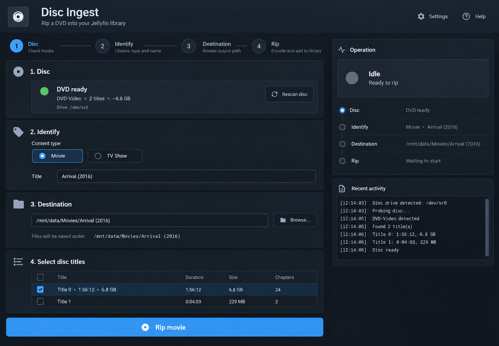

# Disc Ingest

Disc Ingest is a purpose-built web interface for copying a DVD or Blu-ray into
a Jellyfin library as a lossless MKV:

1. Insert the disc and scan it.
2. Choose **Movie** or **TV Show**.
3. Confirm the name, year or season, destination, and selected disc titles.
4. Click **Rip movie** or **Rip episodes**.

Completed files are named for Jellyfin beneath `/mnt/data/Movies` or
`/mnt/data/Shows`. Incomplete work remains in `/mnt/data/.disc-ingest`, which is
hidden from normal Jellyfin library scans.



## Requirements

- A Linux Docker host. Docker Desktop on macOS and Windows generally cannot
  pass a physical optical drive through to its Linux VM.
- Docker Engine with the Docker Compose v2 plugin.
- A USB or SATA DVD/Blu-ray drive visible to Linux.
- Enough storage for uncompressed disc titles.

Only copy media that you are legally entitled to copy. Laws concerning copy
protection differ by jurisdiction.

## Install

Copy the project to the Linux Docker host, then run:

```sh
cp .env.example .env
./scripts/detect-drive.sh
```

Put the detected `OPTICAL_BLOCK_DEVICE`, `OPTICAL_GENERIC_DEVICE`, and
`SUP_GROUP_IDS` into `.env`. Also set:

```dotenv
MEDIA_DIR=/srv/media
USER_ID=1000
GROUP_ID=1000
TZ=Etc/UTC
```

`id -u` and `id -g` print the IDs for the current user. Create the persistent
directories, check the setup, pull the published image, and start the appliance:

```sh
mkdir -p ./data/config /srv/media
./scripts/doctor.sh
docker compose pull
docker compose up -d
```

Open <http://127.0.0.1:8080> on the Docker host.

## Using the appliance

- The page scans the drive once when it opens. Use **Scan disc** after changing
  media.
- For a movie, Disc Ingest selects the longest title by default and writes:
  `/mnt/data/Movies/Name (Year)/Name (Year).mkv`.
- For a show, it selects similarly sized episode-length titles and writes:
  `/mnt/data/Shows/Name/Season 01/Name - S01E01.mkv`, continuing from the chosen
  starting episode.
- Every title checkbox remains editable before starting.
- An existing destination file is never overwritten.
- A successful job ejects the disc when `AUTO_EJECT=1`.

Point Jellyfin at `MEDIA_DIR/Movies` and `MEDIA_DIR/Shows`, or mount the same
host directory into the Jellyfin container. Jellyfin should use its own
container path; it does not need to call the directory `/mnt/data`.

## Access from another computer

For a trusted LAN, change `.env`:

```dotenv
WEB_BIND_ADDRESS=0.0.0.0
WEB_USERNAME=your-name
WEB_PASSWORD=use-a-long-unique-password
```

Then recreate the service:

```sh
docker compose up -d --force-recreate
```

Open `http://DOCKER-HOST-IP:8080`. Basic authentication does not encrypt the
connection; use a TLS reverse proxy or a private network such as Tailscale when
the link is not fully trusted. Do not publish this port directly to the public
internet.

## Operations

```sh
docker compose ps
docker compose logs -f --tail=200
docker compose pull && docker compose up -d
docker compose down
```

The published image is `ghcr.io/aidanhsl/disc-ingest:latest` for Linux amd64.
To build locally instead, run `docker build -t disc-ingest:local .` and set
`image: disc-ingest:local` in `compose.yaml`.

The web application keeps its recent job state in memory. Completed media and
MakeMKV configuration persist through the bind mounts.

## Test the application code

The parser and Jellyfin naming logic use only the Python standard library:

```sh
python3 -m unittest discover -s tests -v
```

## Troubleshooting

- **No disc appears:** run `lsscsi -g`, verify both device paths in `.env`, and
  recreate the container if reconnecting the drive changed its device number.
- **Permission denied:** rerun `detect-drive.sh`, copy `SUP_GROUP_IDS`, and make
  sure `MEDIA_DIR` is writable by `USER_ID:GROUP_ID`.
- **A TV disc selects the wrong titles:** the selection is only a default;
  change the checkboxes before ripping.
- **A failed rip left files:** inspect the path reported in Recent activity
  beneath `.disc-ingest`. They were intentionally kept out of the Jellyfin
  library for diagnosis.
- **MakeMKV key expired:** rebuild/restart after the upstream beta key has been
  refreshed, or put a purchased key in `MAKEMKV_KEY`.

MakeMKV is provided by the upstream
[`jlesage/makemkv`](https://github.com/jlesage/docker-makemkv) image.
